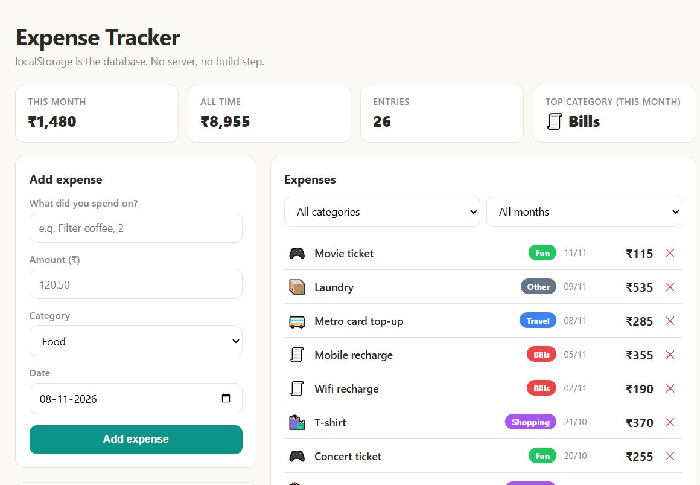

# Expense Tracker

<p>
  
</p>

A working expense tracker in **pure HTML + CSS + JavaScript**. One HTML file, one CSS file, one JS file. No frameworks, no build step, no server — the browser is the runtime and `localStorage` is the database.

## Features

- **Add / delete expenses** — description, amount, category, date
- **Stats row** — this month's spend, all-time total, entry count, top category
- **Filtering** — by category and by month, with a clear-filters shortcut
- **Canvas bar chart** — last 6 months, drawn by hand with the Canvas 2D API (no chart library)
- **Category split** — animated CSS bars with real percentages
- **Persistence** — everything survives tab close and browser restart via `localStorage`
- **Demo data** — one click fills 26 realistic expenses so the board isn't empty on first open

## Run it

Open `index.html`. That's the entire installation procedure.

Optional serving for cleaner URLs:

```bash
python -m http.server 8080
# → http://localhost:8080
```

## How it's built (worth reading before the code)

The whole architecture is one pattern:

> data mutation → `save()` → `render()`

`render()` redraws every section from the single `expenses` array — stats, list, split bars and the canvas chart all derive from state, never from each other. That's the React mental model, built bare-handed.

Good places to start reading (`app.js`):

1. `CATEGORIES` + `formatMoney()` — the domain model
2. `render()` and the four `render*` functions it fans out to
3. `drawChart()` — measure → scale → loop → `fillRect`, with double-resolution backing for retina screens

## The detail worth stealing

**All money is stored as integer paise** (`₹120.50` → `12050`), formatted only at render time. Floats are banned from money math because `0.1 + 0.2 !== 0.3` is how tips become salary. One line of discipline, saved forever.

## License

[MIT](LICENSE)
